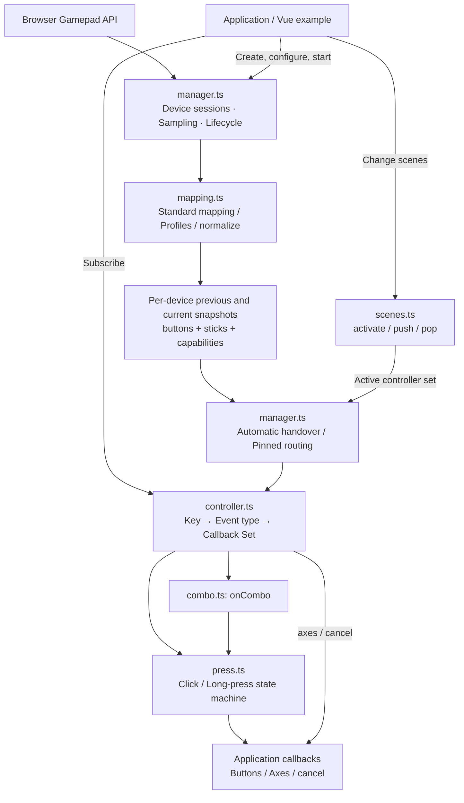

# web-gamepad

**English** | [中文](./README.md)

A TypeScript input library built on the browser Gamepad API, with no runtime dependencies. Logical keys let different devices control the same application events, with automatic device handover and layered UI scenes.

> This document describes the v2 refactor in this repository. The package version is still 1.1.0, with a major Changeset pending; this does not mean v2 has been published to npm. Run the examples from this workspace, and consult the matching documentation when using a published version.

## Core design

- Standard layouts work by default, using uppercase logical abbreviations such as `S`, `LS` and `RS`.
- Each controller preserves the core model: separate event and callback sets for each logical key.
- Buttons support `down`, `up`, `click`, `longpress` and `cancel`; sticks also support `axes`.
- New meaningful input can take over from another connected gamepad. Controllers can also be pinned to individual devices.
- Device profiles support extra buttons, axis-to-button conversion and custom normalization.
- Managers are independent instances that own sampling, routing, scenes, cancellation and cleanup.

## Architecture



`constants.ts` provides public constants, `types.ts` defines configuration, snapshot and event contracts, and `index.ts` exports the API. `packages/core` does not depend on Vue; `packages/examples` is a Vue application using the library.

Each manager maintains at most one pending animation frame and reads the device list once per frame. It copies each device's state so browser mutations of native `Gamepad` objects cannot invalidate comparisons with the previous sample.

## Quick start

From the repository root:

```sh
pnpm install
pnpm dev
```

Basic usage:

```ts
import {
  createGamepadManager,
  STANDARD_KEY as KEY,
  INPUT_TYPE as EVENT,
  MANAGER_EVENT
} from 'web-gamepad'

const manager = createGamepadManager()
const main = manager.createController('main')

// @en Click and long press have separate handlers. @zh 短按和长按分别绑定事件集合。
const offClick = main.on(KEY.S, EVENT.click, (event) => {
  console.log('Confirm / 确认', event.device.name)
})
main.on(KEY.S, EVENT.longpress, (event) => {
  console.log('Long press / 长按', event.durationMs)
})

manager.on(MANAGER_EVENT.devicechange, ({ current }) => {
  console.log('Active device / 当前设备', current?.name)
})

// @en New controllers are inactive until activated. @zh 新建控制器需要显式激活。
manager.activate(main)
if (!manager.start()) {
  console.log('Gamepad API unavailable / 无法读取手柄')
}

// @en Call when leaving the page. @zh 离开页面时调用。
function dispose() {
  offClick()
  manager.destroy()
}
```

The following snippets reuse these imports, including `createGamepadManager`, `KEY` and `EVENT`. Snippets without their own manager also reuse `manager` and `main`. Configuration examples show alternative setups; you do not need to run all managers together.

In Vue, call `start()` in `onMounted` and `destroy()` in `onUnmounted`. Initial discovery, restart and page resume establish an input baseline: buttons already held must be released and pressed again before generating a new press.

## Public constants and standard keys

Public constants use `as const` and are frozen. Types such as `StandardKey` are derived from these constants, so applications do not need a separate list of strings.

```ts
import {
  STANDARD_KEY,
  INPUT_TYPE,
  MANAGER_EVENT,
  MAPPING_TYPE,
  CANCEL_REASON,
  DEFAULT_CONFIG,
  STANDARD_BUTTONS,
  STANDARD_STICKS,
  type StandardKey
} from 'web-gamepad'

const key: StandardKey = STANDARD_KEY.LS
console.log(key, INPUT_TYPE.axes, MANAGER_EVENT.connected)
console.log(MAPPING_TYPE.standard, CANCEL_REASON.devicechange)
console.log(DEFAULT_CONFIG.press.longPressMs)
console.log(STANDARD_BUTTONS.LS, STANDARD_STICKS.LS)
```

| Constant           | Purpose                                           |
| ------------------ | ------------------------------------------------- |
| `STANDARD_KEY`     | Built-in logical keys                             |
| `INPUT_TYPE`       | `down / up / click / longpress / axes / cancel`   |
| `MANAGER_EVENT`    | `connected / disconnected / devicechange / error` |
| `MAPPING_TYPE`     | `standard / custom / unmapped`                    |
| `CANCEL_REASON`    | Input interruption reasons                        |
| `DEFAULT_CONFIG`   | Default gesture, dead-zone and handover settings  |
| `STANDARD_BUTTONS` | Standard logical keys to raw button indices       |
| `STANDARD_STICKS`  | Standard left/right stick axis indices            |

Logical keys represent positions or functions, so application code does not need separate Xbox and PlayStation key maps. The table applies when the browser reports `mapping === 'standard'`; check `device.controls` for actual capabilities.

| Key | Meaning | Standard button index | Common Xbox label | Common PS label |
| --- | --- | --- | --- | --- |
| `S` | South | 0 | A | × |
| `E` | East | 1 | B | ○ |
| `W` | West | 2 | X | □ |
| `N` | North | 3 | Y | △ |
| `LB` / `RB` | Left / right bumper | 4 / 5 | LB / RB | L1 / R1 |
| `LT` / `RT` | Left / right trigger | 6 / 7 | LT / RT | L2 / R2 |
| `BK` | Back | 8 | View | Share / Create |
| `ST` | Start | 9 | Menu | Options |
| `LS` / `RS` | Left / right stick press | 10 / 11 | Stick press | L3 / R3 |
| `DU` / `DD` | D-pad up / down | 12 / 13 | Up / down | Up / down |
| `DL` / `DR` | D-pad left / right | 14 / 15 | Left / right | Left / right |
| `HM` | Home | 16 | Guide | PS |

Standard stick movement uses axes `[0, 1]` for LS and `[2, 3]` for RS. Availability of system keys and extra buttons depends on the data exposed by the browser.

## Button combos: LB + A

Use `onCombo(keys, type, listener, options?)` to bind an event set to multiple buttons. Xbox A maps to `S`, so `LB + A` uses `[KEY.LB, KEY.S]`:

```ts
const shortcut = [KEY.LB, KEY.S] as const // Xbox LB + A / PS L1 + ×

const offCombo = main.onCombo(
  shortcut,
  EVENT.click,
  (event) => console.log('Combo / 组合键', event.keys, event.device.name),
  {
    /** @en Suppress member buttons after recognition. @zh 组合成立后抑制成员按钮事件。 */
    suppressSingles: true
  }
)
main.onCombo(shortcut, EVENT.longpress, (event) => {
  console.log('Combo long press / 组合长按', event.durationMs)
})
main.onCombo(shortcut, EVENT.cancel, (event) => {
  console.log('Combo cancelled / 组合取消', event.reason)
})

// @en Call offCombo() to remove only the click subscription.
// @zh 调用 offCombo() 仅移除上面的 click 订阅。
```

- A combo requires at least two distinct keys. Order does not affect identity: `[LB, S]` and `[S, LB]` share event sets. Three or more buttons, extension keys and LS/RS presses are supported; `axes` is not.
- Members must come from one device and each must produce a fresh press while this binding is eligible for that source. Held members from before a scene change, device handover or page resume are not inherited.
- Members need not be pressed in the same frame, and there is no maximum interval between them. The last member starts `down` and the duration timer; the first release ends the chord with `up`. Click and longpress are mutually exclusive and use the same thresholds and boundaries as single buttons.
- Holding LB while repeatedly pressing and releasing S can trigger multiple combos. Handover, leaving a scene, disabling any member and other interruptions emit `cancel` and reset the chord state.
- Payloads use read-only `event.keys` instead of `event.key`, with keys sorted alphabetically. Button-event `value` is the minimum current member pressure, and `durationMs` starts when the full chord forms.
- Different combos are independent. Overlapping chords such as `LB + S` and `LB + S + E` can both trigger; there is no implicit longest-chord priority.

### Combining combo and single-button handlers

The default `suppressSingles: false` delivers combo and single-button events in parallel. With `true`, recognition cancels unfinished member button gestures in this controller with `CANCEL_REASON.combo`, then suppresses further button events for each consumed member until its release. Stick movement is unaffected.

Combos are processed before singles, so members pressed together in one frame do not emit single-button `down` events. However, if LB is held before S is pressed, an earlier LB `down` or `longpress` cannot be undone. Prefer `click` for actions that should avoid firing early, or coordinate immediate actions in your application.

This option is shared by all subscriptions for the same key set. The first registration establishes the policy; omitted options reuse it, and explicitly conflicting values throw. Once the last subscription is removed, the set can be registered with a different policy. Already consumed member presses remain suppressed until release, preventing accidental single-button events.

## Click, long press and cancellation

The default long-press threshold is **500 ms**. Set it globally or override it per controller:

```ts
const gestures = createGamepadManager({
  /** @en Default gesture settings. @zh 默认按压配置。 */
  press: {
    /** @en Threshold in milliseconds. @zh 阈值，单位毫秒。 */
    longPressMs: 600
  }
})
const menu = gestures.createController('menu', {
  /** @en Override this controller's threshold. @zh 覆盖当前控制器阈值。 */
  press: { longPressMs: 800 }
})
menu.setLongPressMs(1000)
```

| Situation | Event order |
| --- | --- |
| Button pressed | `down` |
| Released before the threshold | `up → click` |
| Held at or beyond the threshold | `longpress`, once per press |
| Released after longpress | `up`, without `click` |
| A sample was missed; release is first observed at or beyond the threshold | `longpress → up` |
| Interrupted by device handover, scene changes, etc. | `cancel`, without synthetic `up` or `click` |

The boundary is `duration < threshold` for click and `duration >= threshold` for long press. Duration starts at the sampled `down`; delivery happens on sampling frames rather than at an exact physical hardware timestamp. Each press captures its threshold at down, so `setLongPressMs()` affects future presses only.

`CANCEL_REASON` exports `combo`, `devicechange`, `disconnect`, `scene`, `disabled`, `stop`, `destroy`, `hidden`, `blur`, `unavailable` and `rebind`. If your application starts a drag on `down`, clean it up on both `up` and `cancel`.

## Stick movement and press

`LS` and `RS` can expose both movement and press capabilities under the same logical key:

```ts
main.on(KEY.LS, EVENT.axes, (event) => {
  const [x, y] = event.value
  console.log('Move / 移动', x, y, 'dt(s)', event.dt)
})
main.on(KEY.LS, EVENT.click, () => console.log('LS click / 左摇杆短按'))
main.on(KEY.RS, EVENT.longpress, () =>
  console.log('RS long press / 右摇杆长按')
)
main.on(KEY.LS, EVENT.cancel, (event) => {
  console.log('Cancelled / 已取消', event.reason)
})
```

`axes.value` is a rescaled `[x, y]` vector after applying a radial dead zone. Negative X points left; negative Y points up. Displaced sticks emit each frame, with one `[0, 0]` event on normal recentering. `dt` is measured in seconds and capped at 0.1, allowing time-based movement and scrolling.

Cancelling a delivered stick input emits a zero vector with `reason` and `dt = 0`, followed by `cancel`. A stick without a press button can still provide movement. Check `controls[].button` before exposing press actions in the UI.

## Automatic Xbox / PS5 handover

Once both devices are visible to the browser and baselined, Xbox A and PS × can invoke the same `KEY.S` subscription without rebinding application callbacks.

1. A new button press, or a rearmed stick reaching the takeover threshold, requests automatic control.
2. A new operation on another gamepad cancels the old device's unfinished input, then delivers the new operation. The `down` that triggers takeover is preserved.
3. Holding or releasing a button, recentering a stick and drift below the threshold do not take over. A stick held away from center must return to the reset region before requesting control again.
4. If several devices qualify in one frame, the current device wins if it is among them; otherwise, stable connection order resolves the tie.

```ts
const switching = createGamepadManager({
  /** @en Normalize sticks with a radial dead zone. @zh 使用径向死区归一化摇杆。 */
  axes: { deadZone: 0.12 },
  /** @en Thresholds use normalized magnitude. @zh 阈值作用于归一化后的幅度。 */
  takeover: {
    /** @en Reach this magnitude to request control. @zh 达到此幅度可申请接管。 */
    threshold: 0.35,
    /** @en Return here before requesting control again. @zh 回落至此幅度后才可再次接管。 */
    resetThreshold: 0.2
  }
})
```

Thresholds use magnitude after dead-zone normalization and require `0 <= resetThreshold < threshold <= 1`. `getActiveDevice()` returns `null` before meaningful input or after the automatic source is cleared. Subscribe to `MANAGER_EVENT.devicechange` to update your UI.

## Scenes and event sets

A controller owns a collection of key events. New controllers are inactive, and the current scene layer determines which controllers receive input:

```ts
const page = manager.createController('page')
const drawer = manager.createController('drawer')
const dialog = manager.createController('dialog')

page.on(KEY.S, EVENT.click, () => manager.push(drawer))
drawer.on(KEY.S, EVENT.click, () => manager.push(dialog))
drawer.on(KEY.E, EVENT.click, () => manager.pop())
dialog.on(KEY.E, EVENT.click, () => manager.pop())
manager.activate(page)

// @en Mouse closes should use the same pop path. @zh 鼠标关闭也应使用同一个 pop 流程。
```

- `activate(controller | controllers[])` replaces the current layer.
- `push(controller | controllers[])` saves the current layer and enters a temporary one.
- `pop()` restores the previous layer; it safely leaves the base layer in place.
- Leaving a scene cancels unfinished input while preserving subscriptions for a later return.
- Scene changes requested by a callback take effect after the current event batch. A release's `up` and `click` stay with the original controller and do not leak into the new scene.
- A held button does not generate a new `down` merely because scenes changed; release and press again. Stick deflection continues to be sampled for the currently active scene.

Multiple controllers can be active in the same layer, each with its own event sets and press state. Registering the same function for the same key and event is deduplicated. Unsubscription is idempotent, and disabled keys still allow subscription maintenance:

```ts
const unsubscribe = main.on(KEY.S, EVENT.down, (event) => {
  console.log(event.key, event.value)
})
main.setEnabled(KEY.S, false)
unsubscribe()
main.setEnabled(KEY.S, true)
```

## Extra buttons: rear paddles, touchpad press and more

Declare additional logical keys through the generic parameter and expose them in a matching device profile. Names must match `^[A-Z][A-Z0-9_]*$`. Device names and indices below are illustrative; inspect raw snapshots before supplying actual mappings:

```ts
const EXTRA_KEY = {
  /** @en First rear button. @zh 第一个背键。 */
  P1: 'P1',
  /** @en Second rear button. @zh 第二个背键。 */
  P2: 'P2'
} as const
type ExtraKey = (typeof EXTRA_KEY)[keyof typeof EXTRA_KEY]

const extended = createGamepadManager<ExtraKey>({
  mappings: [
    {
      /** @en Diagnostic profile identifier. @zh 用于调试的配置标识。 */
      id: 'extended-pad',
      /** @param pad - @en Raw browser device. @zh 浏览器原始设备。 */
      match: (pad) => pad.id.includes('Demo Extended Pad'),
      /** @en Start from standard controls. @zh 继承标准输入。 */
      extends: 'standard',
      buttons: {
        /** @en Example raw button index. @zh 示例原始按钮索引。 */
        [EXTRA_KEY.P1]: 17,
        /** @en Example raw button index. @zh 示例原始按钮索引。 */
        [EXTRA_KEY.P2]: 18,
        /** @en Remove the inherited Home button. @zh 移除继承的主页键。 */
        [KEY.HM]: null
      }
    }
  ]
})
const extendedScene = extended.createController('extended')
extendedScene.on(EXTRA_KEY.P1, EVENT.click, () => console.log('P1'))
extendedScene.on(EXTRA_KEY.P2, EVENT.longpress, () => console.log('P2'))
extended.activate(extendedScene)
extended.start()
```

`extends: 'standard'` explicitly inherits standard controls before applying overrides; `null` removes an inherited capability. For example, `buttons: { LS: null }` removes LS press only, while `sticks: { LS: null }` removes LS movement only.

Extension keys such as `P1`, `P2` and `TP` use the same event sets as standard keys. Additional two-dimensional controls can also be mapped through `sticks` using a declared extension key. A mapping exposes a capability only when the device supplies the corresponding raw input. If hardware aliases a rear button to an existing button such as A, the library cannot distinguish them.

## Nonstandard layouts and axis-to-button mapping

A custom profile without `extends` exposes only its explicitly listed controls. Even if the browser reports a standard layout, a matched custom profile does not inherit it implicitly.

```ts
const custom = createGamepadManager({
  mappings: [
    {
      id: 'legacy-pad',
      /** @param pad - @en Raw browser device. @zh 浏览器原始设备。 */
      match: (pad) => pad.id.includes('Demo Legacy Pad'),
      // @en No inheritance: expose only the following controls.
      // @zh 不继承标准布局，只暴露以下输入。
      buttons: {
        /** @en South button at raw index 2. @zh 下方键位于原始按钮 2。 */
        [KEY.S]: 2,
        /** @en East button at raw index 1. @zh 右侧键位于原始按钮 1。 */
        [KEY.E]: 1,
        /** @en Left stick press at raw index 8. @zh 左摇杆按压位于原始按钮 8。 */
        [KEY.LS]: 8,
        /** @en Trigger exposed as an axis. @zh 由轴数据表示的扳机。 */
        [KEY.LT]: {
          /** @en Raw axis index. @zh 原始轴索引。 */
          axis: 2,
          /** @en Released and fully pressed values. @zh 松开和完全按下时的原始值。 */
          range: [-1, 1],
          /** @en Normalized press threshold. @zh 归一化按下阈值。 */
          pressThreshold: 0.6,
          /** @en Normalized release threshold. @zh 归一化松开阈值。 */
          releaseThreshold: 0.4
        }
      },
      sticks: {
        /** @en Left stick axes; invert vertical direction. @zh 左摇杆轴，反转纵向方向。 */
        [KEY.LS]: { x: 0, y: 1, invertY: true }
      }
    }
  ]
})
const customScene = custom.createController('legacy')
customScene.on(KEY.LT, EVENT.click, () => console.log('LT'))
customScene.on(KEY.LS, EVENT.axes, (event) => console.log(event.value))
custom.activate(customScene)
custom.start()
```

`range` is `[releasedValue, fullyPressedValue]`; use `[1, -1]` for a reversed axis. Values are normalized to `[0, 1]`. Reaching `pressThreshold` presses the button; falling to or below `releaseThreshold` releases it, reducing boundary jitter. Defaults are 0.5 and `min(0.4, pressThreshold)`, respectively. Require `0 <= releaseThreshold <= pressThreshold <= 1` with a positive press threshold.

Profiles are checked in array order, and **the first match wins**. If none matches and the browser does not report a standard layout, the device is `unmapped`: raw inspection remains available, but no guessed logical input is dispatched.

### Fully custom normalization

Use `normalize` for discrete hats or compound encodings that cannot be expressed through index mappings:

```ts
const unusual = createGamepadManager({
  mappings: [
    {
      id: 'vertical-hat',
      /** @param pad - @en Raw browser device. @zh 浏览器原始设备。 */
      match: (pad) => pad.id.includes('Demo Vertical Hat'),
      /**
       * @en Example encoding only: axis 9 is -1 for up, 0 for neutral, 1 for down.
       * @zh 仅演示一种编码：轴 9 的 -1/0/1 分别代表上/中立/下。
       * @param pad - @en Raw browser input; do not mutate it. @zh 浏览器原始输入，请勿修改。
       */
      normalize(pad) {
        const hat = pad.axes[9] ?? 0
        const up = hat < -0.5
        const down = hat > 0.5
        return {
          /** @en Keep neutral entries to declare supported controls. @zh 保留未按下的字段以声明输入能力。 */
          buttons: {
            [KEY.DU]: { pressed: up, value: up ? 1 : 0 },
            [KEY.DD]: { pressed: down, value: down ? 1 : 0 }
          },
          /** @en This adapter exposes no sticks. @zh 此适配器不暴露摇杆。 */
          sticks: {}
        }
      }
    }
  ]
})
const hatScene = unusual.createController('hat')
hatScene.on(KEY.DU, EVENT.click, () => console.log('Up / 上'))
unusual.activate(hatScene)
unusual.start()
```

This demonstrates one encoding, not a universal hat protocol. `normalize` replaces declarative mapping entirely and cannot be combined with `extends`, `buttons` or `sticks`. Return a complete logical state, including released buttons and centered sticks. Missing entries mean unavailable capabilities and affect rising-edge detection and cancellation. The library copies and validates output and still applies the configured stick dead zone.

## Capability queries and raw diagnostics

```ts
// @en Run after the browser has exposed the devices. @zh 在浏览器发现设备后执行。
for (const device of manager.getDevices()) {
  console.log(device.id, device.name, device.mapping, device.profile)
  console.table(device.controls)
  const raw = manager.getRawState(device.id)
  console.log(raw?.buttons, raw?.axes)

  const leftStick = device.controls.find((control) => control.key === KEY.LS)
  console.log('LS press / 按压', leftStick?.button)
  console.log('LS movement / 移动', leftStick?.axes)
}
```

`DeviceInfo.id` identifies a connection session within one manager. Reconnection or restarting after stop allocates a new ID. `DeviceInfo.index` is a reusable browser slot, while `DeviceInfo.name` contains the raw browser `Gamepad.id`. `getRawState()` accepts the session ID; the returned snapshot's `id` is the raw device name. Do not interchange them.

`getRawState()` returns the latest read-only sample, including raw `buttons`, `axes`, `mapping` and `timestamp`. Calling it does not perform another browser read. Device names and indices can vary by connection mode, OS and browser, so verify profiles in the target environment.

## Separate devices for multiple players

Automatic handover suits multiple gamepads controlling one interface. Pin controllers to sessions for independent player input:

```ts
// @en Use devices selected by your application's player-selection UI.
// @zh 实际应用中应使用玩家选择界面选中的设备。
const [first, second] = manager.getDevices()
if (first && second) {
  const player1 = manager.createController('player-1', { deviceId: first.id })
  const player2 = manager.createController('player-2', { deviceId: second.id })
  player1.on(KEY.S, EVENT.click, () => console.log('Player 1'))
  player2.on(KEY.S, EVENT.click, () => console.log('Player 2'))
  manager.activate([player1, player2])

  // @en Later, call player1.setDevice() to restore automatic routing.
  // @zh 之后可调用 player1.setDevice() 恢复自动切换。
}
```

Devices pinned by currently active controllers are excluded from automatic takeover competition. `setDevice(id)` changes the pinned device, while `setDevice()` resumes automatic routing. Both cancel unfinished input from the old source. Reconnected devices receive new session IDs, so the application must select and bind them again.

## API reference

| Manager API | Purpose |
| --- | --- |
| `createGamepadManager(options?)` | Create an isolated instance without starting sampling |
| `start(): boolean` | Start idempotently; false if unavailable or the initial read fails |
| `stop()` | Cancel input, detach listeners and clear sessions; retain scenes and subscriptions |
| `destroy()` | Permanently dispose the manager and controllers; safe to repeat |
| `running` | Started state; remains true during temporary blur/visibility suspension |
| `createController(name, options?)` | Create an inactive controller with optional `deviceId` and `press` |
| `activate / push / pop` | Replace the current scene / enter a temporary scene / return |
| `getActiveControllers()` | Controllers in the current layer |
| `getDevices() / getActiveDevice()` | Visible sessions / current automatic source |
| `getRawState(deviceId)` | Latest raw sample; undefined for unknown sessions |
| `on(type, listener)` | Subscribe to manager events; returns an unsubscribe function |

| Controller API | Purpose |
| --- | --- |
| `id / name / deviceId` | Controller ID / scene name / optional pinned session |
| `on(key, type, listener)` | Add a callback to a key's event set; returns an unsubscribe function |
| `onCombo(keys, type, listener, options?)` | Subscribe to a same-device chord; returns an unsubscribe function |
| `setEnabled(key, enabled) / isEnabled(key)` | Manage key availability; disabling cancels pending input |
| `setDevice(deviceId?)` | Pin a session, or omit it for automatic routing |
| `setLongPressMs(durationMs)` | Set a finite positive threshold for future presses |
| `destroy()` | Clear subscriptions and remove the controller from scene history |

| Manager event | Payload |
| --- | --- |
| `connected` | `{ device }` |
| `disconnected` | `{ device }` |
| `devicechange` | `{ previous, current, reason }`; either device can be null |
| `error` | `{ error }`; logged to the console when no listener is registered |

Button events contain `key / type / device / timestamp / value / durationMs`. Axis events contain vector `value`, `dt` and optional `reason`. Cancellation events contain `reason / durationMs`. Callback payloads are inferred from the event type; events and device metadata are read-only.

| Manager option            | Default | Constraints                  |
| ------------------------- | ------- | ---------------------------- |
| `mappings`                | `[]`    | Profiles in priority order   |
| `press.longPressMs`       | 500     | Finite positive milliseconds |
| `axes.deadZone`           | 0.12    | `[0, 1)`                     |
| `takeover.threshold`      | 0.35    | `(resetThreshold, 1]`        |
| `takeover.resetThreshold` | 0.2     | `[0, threshold)`             |

Page hiding or blur cancels input and pauses sampling. Resume establishes a new baseline so background presses cannot become accidental clicks. Callback exceptions are isolated and reported. A sampling API failure stops the manager; the application can explicitly restart it once the environment recovers.

## Migrating from v1

v2 is a breaking refactor with no compatibility layer for the old global APIs.

| v1 | v2 |
| --- | --- |
| `initGamepad(...)` | `createGamepadManager(...)`, then explicit `start()` |
| Global `createGamepadController(...)` | `manager.createController(...)` |
| Brand maps such as `XBOX_KEY_MAP` / `PS_KEY_MAP` | `STANDARD_KEY`, with special devices in `mappings` |
| `addBtnEvents(...)` | `controller.on(key, type, listener)` |
| Global controller switching / rollback | `manager.activate / push / pop` |
| Axis callback receives an array | Read `event.value` and elapsed seconds from `event.dt` |
| `axes.deadZoneRadius` | `axes.deadZone` |
| Connection callbacks in initialization options | `manager.on(MANAGER_EVENT.connected, listener)` |

## Local development and validation

Use Node.js 20+ and pnpm 9 from the repository root:

```sh
pnpm install
pnpm dev
pnpm test
pnpm typecheck
pnpm build
```

`pnpm test` builds the core, checks public types and runs simulated-browser behavior tests for gesture boundaries, handover, custom mappings, scenes and lifecycle. `pnpm build` produces the core ESM/CJS bundles and example application. Automated tests do not replace compatibility checks with physical Xbox, PS5 or other hardware.

The example's TypeScript `paths` and Vite alias both point to `packages/core/src/index.ts`, so local implementation and JSDoc are available without building declarations first. If the editor still shows an older package, restart its TypeScript / Vue language service. Source imports omit `.js`; the build adds matching extensions to published ESM/CJS declarations.

After editing documentation, run `node scripts/copyReadme.mjs` from the root to synchronize both READMEs into `packages/core`. Published artifacts include corresponding `.d.ts` and `.d.cts` entry points.

## Runtime scope

The browser must expose the Gamepad API. Devices may become visible only after user interaction; the first interaction may simply discover and baseline the device. The library handles buttons and axes exposed by that API. It cannot distinguish controls already merged by a driver, and it does not add touch coordinates, gyroscope or vibration APIs.

## License

MIT
