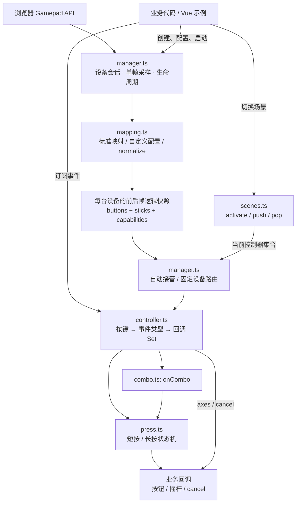

# web-gamepad

**中文** | [English](./README.en.md)

基于浏览器 Gamepad API 的 TypeScript 输入库，无运行时依赖。通过统一逻辑按键，让不同手柄控制相同的业务事件，并支持自动切换输入设备和多层 UI 场景。

> 本文描述仓库中的 v2 重构 API。当前包版本仍为 1.1.0，重大变更已记录在 Changeset 中；本文不表示 v2 已发布到 npm。请在本仓库运行示例，使用已发布包时以对应版本文档为准。

## 核心设计

- 标准布局默认可用，业务代码使用 `S`、`LS`、`RS` 等大写逻辑缩写。
- 保留“不同按键绑定不同事件集合”：每个控制器按逻辑键分别管理事件和回调集合。
- 按钮支持 `down`、`up`、`click`、`longpress`、`cancel`；摇杆还支持 `axes`。
- 同时连接多只手柄，依据新的有效操作自动切换；也可为玩家固定绑定设备。
- 特殊手柄通过映射配置适配，支持附加按键、轴转按钮以及自定义归一化。
- 管理器按实例隔离，统一负责采样、场景、取消事件及资源释放。

## 架构



`constants.ts` 提供公共常量，`types.ts` 定义配置、快照和事件契约，`index.ts` 汇总导出。`packages/core` 不依赖 Vue；`packages/examples` 只是使用该库的 Vue 演示。

每个管理器至多保持一个待执行的动画帧，每帧读取一次设备列表。每台设备独立保存复制后的状态，避免浏览器原地更新 `Gamepad` 对象导致前后帧比较失效。

## 快速开始

在本仓库根目录运行：

```sh
pnpm install
pnpm dev
```

核心用法：

```ts
import {
  createGamepadManager,
  STANDARD_KEY as KEY,
  INPUT_TYPE as EVENT,
  MANAGER_EVENT
} from 'web-gamepad'

const manager = createGamepadManager()
const main = manager.createController('main')

// @en Click and long press have separate handlers. @zh 短按和长按分别绑定事件集合。
const offClick = main.on(KEY.S, EVENT.click, (event) => {
  console.log('Confirm / 确认', event.device.name)
})
main.on(KEY.S, EVENT.longpress, (event) => {
  console.log('Long press / 长按', event.durationMs)
})

manager.on(MANAGER_EVENT.devicechange, ({ current }) => {
  console.log('Active device / 当前设备', current?.name)
})

// @en New controllers are inactive until activated. @zh 新建控制器需要显式激活。
manager.activate(main)
if (!manager.start()) {
  console.log('Gamepad API unavailable / 无法读取手柄')
}

// @en Call when leaving the page. @zh 离开页面时调用。
function dispose() {
  offClick()
  manager.destroy()
}
```

以下片段沿用上面的 `createGamepadManager`、`KEY`、`EVENT` 等导入；未单独创建管理器的片段沿用 `manager` 和 `main`。各配置案例用于展示不同方案，不需要同时创建多个管理器。

Vue 中将 `start()` 放在 `onMounted`，将 `destroy()` 放在 `onUnmounted`。首次发现设备、重新启动以及页面恢复时会建立输入基线：已经按住的按钮需先松开，再按下才会产生新的按压事件。

## 公共常量与标准按键

公共常量使用 `as const` 定义并冻结，可直接导入；`StandardKey` 等类型从常量推导，不需要维护另一套字符串。

```ts
import {
  STANDARD_KEY,
  INPUT_TYPE,
  MANAGER_EVENT,
  MAPPING_TYPE,
  CANCEL_REASON,
  DEFAULT_CONFIG,
  STANDARD_BUTTONS,
  STANDARD_STICKS,
  type StandardKey
} from 'web-gamepad'

const key: StandardKey = STANDARD_KEY.LS
console.log(key, INPUT_TYPE.axes, MANAGER_EVENT.connected)
console.log(MAPPING_TYPE.standard, CANCEL_REASON.devicechange)
console.log(DEFAULT_CONFIG.press.longPressMs)
console.log(STANDARD_BUTTONS.LS, STANDARD_STICKS.LS)
```

| 常量               | 用途                                              |
| ------------------ | ------------------------------------------------- |
| `STANDARD_KEY`     | 内置逻辑按键                                      |
| `INPUT_TYPE`       | `down / up / click / longpress / axes / cancel`   |
| `MANAGER_EVENT`    | `connected / disconnected / devicechange / error` |
| `MAPPING_TYPE`     | `standard / custom / unmapped`                    |
| `CANCEL_REASON`    | 输入中断原因                                      |
| `DEFAULT_CONFIG`   | 默认长按、死区和接管阈值                          |
| `STANDARD_BUTTONS` | 标准逻辑键对应的原始按钮索引                      |
| `STANDARD_STICKS`  | 标准左右摇杆的原始轴索引                          |

逻辑键表达位置或功能，业务不必传入 Xbox、PS 各自的品牌按键表。以下对应关系适用于浏览器报告 `mapping === 'standard'` 的布局，具体能力以 `device.controls` 为准。

| 逻辑键 | 含义 | 标准按钮索引 | Xbox 常见标识 | PS 常见标识 |
| --- | --- | --- | --- | --- |
| `S` | 下方 / South | 0 | A | × |
| `E` | 右侧 / East | 1 | B | ○ |
| `W` | 左侧 / West | 2 | X | □ |
| `N` | 上方 / North | 3 | Y | △ |
| `LB` / `RB` | 左 / 右肩键 | 4 / 5 | LB / RB | L1 / R1 |
| `LT` / `RT` | 左 / 右扳机 | 6 / 7 | LT / RT | L2 / R2 |
| `BK` | 返回 | 8 | View | Share / Create |
| `ST` | 开始 | 9 | Menu | Options |
| `LS` / `RS` | 左 / 右摇杆按压 | 10 / 11 | 摇杆按压 | L3 / R3 |
| `DU` / `DD` | 十字键上 / 下 | 12 / 13 | 上 / 下 | 上 / 下 |
| `DL` / `DR` | 十字键左 / 右 | 14 / 15 | 左 / 右 | 左 / 右 |
| `HM` | 主页 | 16 | Guide | PS |

左右摇杆移动分别读取标准轴 `[0, 1]`、`[2, 3]`。系统键和附加按键是否可读，取决于浏览器实际暴露的数据。

## 组合键：LB + A

通过 `onCombo(keys, type, listener, options?)` 为多个按钮绑定事件集合。Xbox A 对应 `S`，所以 `LB + A` 使用 `[KEY.LB, KEY.S]`：

```ts
const shortcut = [KEY.LB, KEY.S] as const // Xbox LB + A / PS L1 + ×

const offCombo = main.onCombo(
  shortcut,
  EVENT.click,
  (event) => console.log('Combo / 组合键', event.keys, event.device.name),
  {
    /** @en Suppress member buttons after recognition. @zh 组合成立后抑制成员按钮事件。 */
    suppressSingles: true
  }
)
main.onCombo(shortcut, EVENT.longpress, (event) => {
  console.log('Combo long press / 组合长按', event.durationMs)
})
main.onCombo(shortcut, EVENT.cancel, (event) => {
  console.log('Combo cancelled / 组合取消', event.reason)
})

// @en Call offCombo() to remove only the click subscription.
// @zh 调用 offCombo() 仅移除上面的 click 订阅。
```

- 至少包含两个不同按键，顺序不影响组合身份；`[LB, S]` 与 `[S, LB]` 共用事件集合。可以包含三个或更多按钮、扩展键，以及 LS / RS 的按压，但不支持 `axes`。
- 成员必须来自同一设备，且在此绑定可接收该输入源的期间分别产生过新的按下。切换场景、切换设备或恢复页面前已按住的成员不能直接带入组合。
- 不要求同帧按下，也不限制成员之间的间隔。最后一个成员按下时触发 `down` 并开始计时，任意成员松开时触发 `up`。短按、长按互斥，阈值及边界与单键相同。
- 可以一直按住 LB，重复按下和松开 S，多次触发组合；切换设备、离开场景、禁用任一成员等中断会触发 `cancel`，清除组合按压状态。
- 回调使用只读 `event.keys` 替代单键的 `event.key`，按键按字母顺序排序。按钮事件的 `value` 是当前成员压力的最小值，`durationMs` 从组合完整成立时计算。
- 不同组合分别识别，重叠组合可以同时触发，例如 `LB + S` 与 `LB + S + E`；不隐式指定最长组合优先。

### 组合与单键的冲突策略

默认 `suppressSingles: false`，组合和单键事件并行。`true` 只影响当前控制器：组合成立时，成员尚未结束的单键按钮手势收到 `cancel`，原因为 `CANCEL_REASON.combo`；随后抑制成员的按钮事件，直到该成员松开。摇杆移动事件不受影响。

组合在单键之前处理，因此同帧按齐的成员不会产生单键 `down`。但先按住 LB、稍后再按 S 时，之前交付的 LB `down` 或 `longpress` 无法撤回。若某个单键操作必须避免过早触发，优先绑定 `click`，或在业务中协调即时行为。

此选项由同一按键集合的所有事件订阅共用。首次注册时确定策略，后续省略选项会沿用已有值，显式传入冲突值会报错。最后一个订阅移除后可重新配置；已经消耗的成员按压仍保持抑制到松开，避免补发意外单键事件。

## 短按、长按与取消

默认长按阈值为 **500 ms**，可在管理器或控制器上配置：

```ts
const gestures = createGamepadManager({
  /** @en Default gesture settings. @zh 默认按压配置。 */
  press: {
    /** @en Threshold in milliseconds. @zh 阈值，单位毫秒。 */
    longPressMs: 600
  }
})
const menu = gestures.createController('menu', {
  /** @en Override this controller's threshold. @zh 覆盖当前控制器阈值。 */
  press: { longPressMs: 800 }
})
menu.setLongPressMs(1000)
```

| 情况 | 事件顺序 |
| --- | --- |
| 按下 | `down` |
| 按住时长小于阈值后松开 | `up → click` |
| 按住时长达到或超过阈值 | `longpress`，每次按压仅一次 |
| 已触发长按后松开 | `up`，不再触发 `click` |
| 中间采样帧缺失，首次观察到松开时已达到阈值 | `longpress → up` |
| 切换设备、离开场景等中断 | `cancel`，不补发 `up` 或 `click` |

边界采用 `duration < threshold` 为短按、`duration >= threshold` 为长按。计时从采样到 `down` 开始，事件在采样帧中交付，不承诺精确到物理按键的毫秒级触发时间。阈值在按下时固定，`setLongPressMs()` 只影响后续按压。

取消原因通过 `CANCEL_REASON` 导出：`combo`、`devicechange`、`disconnect`、`scene`、`disabled`、`stop`、`destroy`、`hidden`、`blur`、`unavailable`、`rebind`。例如业务在 `down` 开始拖拽，应同时在 `up` 和 `cancel` 中清理拖拽状态。

## 摇杆移动与按压

`LS`、`RS` 可以同时拥有移动和按压能力，使用同一个逻辑键订阅：

```ts
main.on(KEY.LS, EVENT.axes, (event) => {
  const [x, y] = event.value
  console.log('Move / 移动', x, y, 'dt(s)', event.dt)
})
main.on(KEY.LS, EVENT.click, () => console.log('LS click / 左摇杆短按'))
main.on(KEY.RS, EVENT.longpress, () =>
  console.log('RS long press / 右摇杆长按')
)
main.on(KEY.LS, EVENT.cancel, (event) => {
  console.log('Cancelled / 已取消', event.reason)
})
```

`axes.value` 是应用径向死区后重新缩放的 `[x, y]`；负 X 向左，负 Y 向上。偏转时每帧交付，正常回中时交付一次 `[0, 0]`。`dt` 的单位为秒，上限为 0.1，适合按时间计算移动或滚动速度。

正在交付的摇杆输入被取消时，先发送带 `reason` 的零向量事件（`dt = 0`），再发送 `cancel`。没有按压能力的摇杆仍可接收移动事件；是否可按压应检查 `controls[].button`。

## Xbox 与 PS5 自动热切换

当两台设备都已被浏览器发现并完成基线采样后，同一套 `KEY.S` 事件可由 Xbox 的 A 或 PS 的 × 触发，业务不需要重新绑定。

1. 新的按钮按下，或已回到复位区的摇杆达到接管阈值，会申请成为自动输入源。
2. 另一只手柄产生上述新操作时，取消旧设备尚未结束的输入，然后交付新设备的触发操作；用于接管的首次 `down` 不会被吞掉。
3. 持续按住、松开按钮、摇杆回中及未达到阈值的漂移不会抢占输入。摇杆持续偏转也不会反复抢占，需先回到复位区。
4. 同一帧有多个候选设备时，当前设备若也在候选中则优先，否则按稳定的连接顺序选择。

```ts
const switching = createGamepadManager({
  /** @en Normalize sticks with a radial dead zone. @zh 使用径向死区归一化摇杆。 */
  axes: { deadZone: 0.12 },
  /** @en Thresholds use normalized magnitude. @zh 阈值作用于归一化后的幅度。 */
  takeover: {
    /** @en Reach this magnitude to request control. @zh 达到此幅度可申请接管。 */
    threshold: 0.35,
    /** @en Return here before requesting control again. @zh 回落至此幅度后才可再次接管。 */
    resetThreshold: 0.2
  }
})
```

接管阈值基于应用死区后的幅度，要求 `0 <= resetThreshold < threshold <= 1`。尚无有效操作或输入源被清除时，`getActiveDevice()` 返回 `null`；通过 `MANAGER_EVENT.devicechange` 更新界面。

## 场景与事件集合

一个控制器代表一组按键事件。新控制器不会自动激活，场景栈的当前层决定哪些控制器接收输入：

```ts
const page = manager.createController('page')
const drawer = manager.createController('drawer')
const dialog = manager.createController('dialog')

page.on(KEY.S, EVENT.click, () => manager.push(drawer))
drawer.on(KEY.S, EVENT.click, () => manager.push(dialog))
drawer.on(KEY.E, EVENT.click, () => manager.pop())
dialog.on(KEY.E, EVENT.click, () => manager.pop())
manager.activate(page)

// @en Mouse closes should use the same pop path. @zh 鼠标关闭也应使用同一个 pop 流程。
```

- `activate(controller | controllers[])` 替换当前层。
- `push(controller | controllers[])` 保存当前层并进入临时层。
- `pop()` 返回上一层，在基础层调用不会继续弹出。
- 离开当前层会取消该控制器未完成的输入；返回时保留事件订阅。
- 回调中的场景修改在当前事件批次结束后生效。同次松开的 `up` 和 `click` 仍交付给原控制器，不会穿透到新场景。
- 已按住的按钮不会因切换场景重新触发 `down`，需松开再按。摇杆偏转则按当前激活场景持续采样。

同一层可以激活多个控制器，它们各自维护事件集合和长按状态。同一按键、同一事件重复注册同一个函数会去重；取消订阅可重复调用。禁用键不会妨碍增删订阅：

```ts
const unsubscribe = main.on(KEY.S, EVENT.down, (event) => {
  console.log(event.key, event.value)
})
main.setEnabled(KEY.S, false)
unsubscribe()
main.setEnabled(KEY.S, true)
```

## 扩展按键：背键、触摸板按压等

用泛型声明额外逻辑键，并在匹配的设备配置中补充映射。扩展名必须匹配 `^[A-Z][A-Z0-9_]*$`。以下设备名称、按钮索引均为演示值，应先查看原始快照，再填写真实配置：

```ts
const EXTRA_KEY = {
  /** @en First rear button. @zh 第一个背键。 */
  P1: 'P1',
  /** @en Second rear button. @zh 第二个背键。 */
  P2: 'P2'
} as const
type ExtraKey = (typeof EXTRA_KEY)[keyof typeof EXTRA_KEY]

const extended = createGamepadManager<ExtraKey>({
  mappings: [
    {
      /** @en Diagnostic profile identifier. @zh 用于调试的配置标识。 */
      id: 'extended-pad',
      /** @param pad - @en Raw browser device. @zh 浏览器原始设备。 */
      match: (pad) => pad.id.includes('Demo Extended Pad'),
      /** @en Start from standard controls. @zh 继承标准输入。 */
      extends: 'standard',
      buttons: {
        /** @en Example raw button index. @zh 示例原始按钮索引。 */
        [EXTRA_KEY.P1]: 17,
        /** @en Example raw button index. @zh 示例原始按钮索引。 */
        [EXTRA_KEY.P2]: 18,
        /** @en Remove the inherited Home button. @zh 移除继承的主页键。 */
        [KEY.HM]: null
      }
    }
  ]
})
const extendedScene = extended.createController('extended')
extendedScene.on(EXTRA_KEY.P1, EVENT.click, () => console.log('P1'))
extendedScene.on(EXTRA_KEY.P2, EVENT.longpress, () => console.log('P2'))
extended.activate(extendedScene)
extended.start()
```

`extends: 'standard'` 表示先继承标准布局，再覆盖指定来源；`null` 删除继承的能力。例如 `buttons: { LS: null }` 只删除 LS 按压，`sticks: { LS: null }` 只删除 LS 移动。

`P1`、`P2`、`TP` 等扩展键与标准键使用相同事件集合。额外的二维输入也可通过 `sticks` 映射到泛型声明的扩展键。只有设备实际暴露对应原始输入时，映射才会产生能力；硬件将背键复用为 A 等现有按钮时，库无法凭空区分两者。

## 非标准布局与轴转按钮

没有声明 `extends` 的自定义配置只包含显式列出的输入。即使设备报告为标准映射，一旦匹配到此配置，也不会隐式继承标准布局。

```ts
const custom = createGamepadManager({
  mappings: [
    {
      id: 'legacy-pad',
      /** @param pad - @en Raw browser device. @zh 浏览器原始设备。 */
      match: (pad) => pad.id.includes('Demo Legacy Pad'),
      // @en No inheritance: expose only the following controls.
      // @zh 不继承标准布局，只暴露以下输入。
      buttons: {
        /** @en South button at raw index 2. @zh 下方键位于原始按钮 2。 */
        [KEY.S]: 2,
        /** @en East button at raw index 1. @zh 右侧键位于原始按钮 1。 */
        [KEY.E]: 1,
        /** @en Left stick press at raw index 8. @zh 左摇杆按压位于原始按钮 8。 */
        [KEY.LS]: 8,
        /** @en Trigger exposed as an axis. @zh 由轴数据表示的扳机。 */
        [KEY.LT]: {
          /** @en Raw axis index. @zh 原始轴索引。 */
          axis: 2,
          /** @en Released and fully pressed values. @zh 松开和完全按下时的原始值。 */
          range: [-1, 1],
          /** @en Normalized press threshold. @zh 归一化按下阈值。 */
          pressThreshold: 0.6,
          /** @en Normalized release threshold. @zh 归一化松开阈值。 */
          releaseThreshold: 0.4
        }
      },
      sticks: {
        /** @en Left stick axes; invert vertical direction. @zh 左摇杆轴，反转纵向方向。 */
        [KEY.LS]: { x: 0, y: 1, invertY: true }
      }
    }
  ]
})
const customScene = custom.createController('legacy')
customScene.on(KEY.LT, EVENT.click, () => console.log('LT'))
customScene.on(KEY.LS, EVENT.axes, (event) => console.log(event.value))
custom.activate(customScene)
custom.start()
```

`range` 按 `[松开值, 完全按下值]` 填写，`[1, -1]` 可以处理反向轴。数值先归一化到 `[0, 1]`，达到 `pressThreshold` 时按下，回落至 `releaseThreshold` 及以下时松开，从而减少边界抖动。默认按下阈值为 0.5，松开阈值为 `min(0.4, pressThreshold)`，配置要求 `0 <= releaseThreshold <= pressThreshold <= 1` 且按下阈值大于零。

多个配置按数组顺序匹配，**第一个匹配项生效**。没有匹配项且浏览器未报告标准布局时，设备标记为 `unmapped`，可以查看原始输入，但不会猜测按键并分发业务事件。

### 完全自定义归一化

离散方向帽、复合编码等无法用索引映射表达时，可提供 `normalize`：

```ts
const unusual = createGamepadManager({
  mappings: [
    {
      id: 'vertical-hat',
      /** @param pad - @en Raw browser device. @zh 浏览器原始设备。 */
      match: (pad) => pad.id.includes('Demo Vertical Hat'),
      /**
       * @en Example encoding only: axis 9 is -1 for up, 0 for neutral, 1 for down.
       * @zh 仅演示一种编码：轴 9 的 -1/0/1 分别代表上/中立/下。
       * @param pad - @en Raw browser input; do not mutate it. @zh 浏览器原始输入，请勿修改。
       */
      normalize(pad) {
        const hat = pad.axes[9] ?? 0
        const up = hat < -0.5
        const down = hat > 0.5
        return {
          /** @en Keep neutral entries to declare supported controls. @zh 保留未按下的字段以声明输入能力。 */
          buttons: {
            [KEY.DU]: { pressed: up, value: up ? 1 : 0 },
            [KEY.DD]: { pressed: down, value: down ? 1 : 0 }
          },
          /** @en This adapter exposes no sticks. @zh 此适配器不暴露摇杆。 */
          sticks: {}
        }
      }
    }
  ]
})
const hatScene = unusual.createController('hat')
hatScene.on(KEY.DU, EVENT.click, () => console.log('Up / 上'))
unusual.activate(hatScene)
unusual.start()
```

这只是自定义编码示例，并非通用方向帽协议。`normalize` 完全替代声明式映射，不能与 `extends`、`buttons`、`sticks` 同时配置。返回完整逻辑状态，保留未按下按钮和回中摇杆的字段；缺少字段表示能力不可用，会影响按下沿检测和取消逻辑。库会复制、校验输出，并对摇杆继续应用配置的死区。

## 能力查询与原始输入调试

```ts
// @en Run after the browser has exposed the devices. @zh 在浏览器发现设备后执行。
for (const device of manager.getDevices()) {
  console.log(device.id, device.name, device.mapping, device.profile)
  console.table(device.controls)
  const raw = manager.getRawState(device.id)
  console.log(raw?.buttons, raw?.axes)

  const leftStick = device.controls.find((control) => control.key === KEY.LS)
  console.log('LS press / 按压', leftStick?.button)
  console.log('LS movement / 移动', leftStick?.axes)
}
```

`DeviceInfo.id` 是管理器内的连接会话 ID；断开重连或停止后重启会分配新的 ID。`DeviceInfo.index` 是可能被复用的浏览器槽位，`DeviceInfo.name` 是浏览器原始 `Gamepad.id`。`getRawState()` 接收会话 ID，而返回快照中的 `id` 是原始设备名称，两者不要混用。

`getRawState()` 返回最近采样的只读副本，包含原始 `buttons`、`axes`、`mapping` 和 `timestamp`。读取该方法不会额外触发浏览器采样。设备名称和原始索引可能随连接方式、操作系统和浏览器改变，适配配置应在目标环境验证。

## 多人分别绑定设备

自动热切换适合多只手柄控制同一个用户界面；多人独立控制时，按会话绑定：

```ts
// @en Use devices selected by your application's player-selection UI.
// @zh 实际应用中应使用玩家选择界面选中的设备。
const [first, second] = manager.getDevices()
if (first && second) {
  const player1 = manager.createController('player-1', { deviceId: first.id })
  const player2 = manager.createController('player-2', { deviceId: second.id })
  player1.on(KEY.S, EVENT.click, () => console.log('Player 1'))
  player2.on(KEY.S, EVENT.click, () => console.log('Player 2'))
  manager.activate([player1, player2])

  // @en Later, call player1.setDevice() to restore automatic routing.
  // @zh 之后可调用 player1.setDevice() 恢复自动切换。
}
```

当前激活控制器固定绑定的设备不会参与自动输入源竞争。`setDevice(id)` 更换固定设备，`setDevice()` 恢复跟随自动输入源，两者都会取消旧来源的未完成输入。设备重连后会话 ID 改变，固定绑定需要由业务重新选择和绑定。

## API 速查

| 管理器 API | 作用 |
| --- | --- |
| `createGamepadManager(options?)` | 创建独立实例，尚不启动采样 |
| `start(): boolean` | 幂等启动；环境不可用或首次读取失败返回 false |
| `stop()` | 取消输入、停止监听并清空设备会话，保留场景和订阅 |
| `destroy()` | 永久清理管理器和控制器，可重复调用 |
| `running` | 已启动状态；临时失焦或隐藏期间仍为 true |
| `createController(name, options?)` | 创建未激活控制器；支持 `deviceId` 和 `press` |
| `activate / push / pop` | 替换当前场景 / 进入临时场景 / 返回 |
| `getActiveControllers()` | 当前层控制器列表 |
| `getDevices() / getActiveDevice()` | 可见设备列表 / 当前自动输入源 |
| `getRawState(deviceId)` | 最近原始快照，未知会话返回 undefined |
| `on(type, listener)` | 订阅管理器事件，返回取消订阅函数 |

| 控制器 API | 作用 |
| --- | --- |
| `id / name / deviceId` | 控制器标识 / 场景名称 / 可选固定设备 |
| `on(key, type, listener)` | 向按键事件集合添加回调，返回取消订阅函数 |
| `onCombo(keys, type, listener, options?)` | 订阅同设备组合键事件，返回取消订阅函数 |
| `setEnabled(key, enabled) / isEnabled(key)` | 控制按键可用性；禁用时取消未完成输入 |
| `setDevice(deviceId?)` | 固定绑定设备，省略则跟随自动切换 |
| `setLongPressMs(durationMs)` | 修改后续按压阈值，必须为有限正数 |
| `destroy()` | 清理订阅并从场景历史中移除 |

| 管理器事件     | 回调参数                                           |
| -------------- | -------------------------------------------------- |
| `connected`    | `{ device }`                                       |
| `disconnected` | `{ device }`                                       |
| `devicechange` | `{ previous, current, reason }`；新旧设备可为 null |
| `error`        | `{ error }`；未订阅时输出到控制台                  |

按钮事件提供 `key / type / device / timestamp / value / durationMs`；摇杆事件提供向量 `value`、`dt` 和可选 `reason`；取消事件提供 `reason / durationMs`。参数根据事件类型自动推导，事件及设备元数据为只读。

| 管理器配置                | 默认值 | 限制                     |
| ------------------------- | ------ | ------------------------ |
| `mappings`                | `[]`   | 按优先级排列的自定义配置 |
| `press.longPressMs`       | 500    | 有限正数，毫秒           |
| `axes.deadZone`           | 0.12   | `[0, 1)`                 |
| `takeover.threshold`      | 0.35   | `(resetThreshold, 1]`    |
| `takeover.resetThreshold` | 0.2    | `[0, threshold)`         |

页面隐藏或失焦时会取消输入并暂停采样；恢复后重新建立基线，避免后台按压变成意外点击。业务回调错误会被隔离并报告；采样 API 失效时管理器停止，恢复环境后可显式重新启动。

## 从 v1 迁移

v2 是破坏性重构，没有保留旧全局 API 的兼容层。

| v1 | v2 |
| --- | --- |
| `initGamepad(...)` | `createGamepadManager(...)` 后显式 `start()` |
| 全局 `createGamepadController(...)` | `manager.createController(...)` |
| `XBOX_KEY_MAP` / `PS_KEY_MAP` 等品牌映射 | `STANDARD_KEY`，特殊设备放入 `mappings` |
| `addBtnEvents(...)` | `controller.on(key, type, listener)` |
| 全局切换 / 回退控制器 | `manager.activate / push / pop` |
| 摇杆回调直接接收数组 | 从 `event.value` 读取向量，`event.dt` 读取秒数 |
| `axes.deadZoneRadius` | `axes.deadZone` |
| 初始化参数中的连接回调 | `manager.on(MANAGER_EVENT.connected, listener)` |

## 本地开发与验证

使用 Node.js 20+、pnpm 9，在仓库根目录执行：

```sh
pnpm install
pnpm dev
pnpm test
pnpm typecheck
pnpm build
```

`pnpm test` 会构建核心包、检查公共类型并运行模拟浏览器的行为测试，覆盖按压边界、热切换、特殊映射、场景和生命周期。`pnpm build` 生成核心 ESM/CJS 产物及示例页面。自动测试不等同于真实 Xbox、PS5 或其他硬件的兼容性测试。

示例的 TypeScript `paths` 与 Vite alias 都指向 `packages/core/src/index.ts`，开发时直接读取本地实现及 JSDoc，无需先生成声明文件。若编辑器仍显示旧包类型，可重新启动其 TypeScript / Vue 语言服务。源码内部导入不带 `.js`；构建时为发布的 ESM/CJS 类型声明补上对应扩展名。

更新文档后，从根目录执行 `node scripts/copyReadme.mjs`，同步中英文 README 到 `packages/core`。发布包提供对应的 `.d.ts` 和 `.d.cts` 类型入口。

## 运行范围

需要浏览器暴露 Gamepad API。浏览器可能在用户实际操作手柄之后才公开设备，首次操作可能仅用于发现设备和建立基线。库只处理该 API 提供的按钮与轴数据，无法区分驱动已合并的按键，也不额外提供触摸坐标、陀螺仪或震动 API。

## License

MIT
